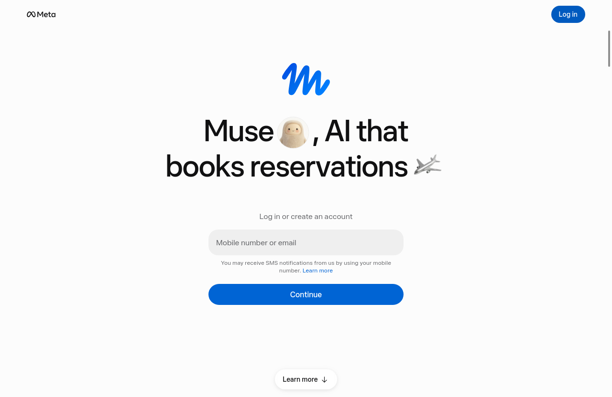

# Muse for Linux

Muse for your Linux desktop. Meta makes Muse for Mac, iOS,
Android and the web, but not Linux. This app fills the gap:
sign in once and use Muse like any other desktop app.

> Unofficial app by [nordicnode](https://github.com/nordicnode).
> Not affiliated with or endorsed by Meta. Muse is Meta's
> service, so you need a Muse account and Meta's terms and
> regional availability apply.



## Download and install

Grab a file from
[Releases](https://github.com/nordicnode/muse-linux/releases)
and pick whichever suits you:

**AppImage (easiest, nothing to install)**

```sh
chmod +x Muse-*.AppImage
./Muse-*.AppImage
```

**Debian / Ubuntu package**

```sh
sudo apt install ./muse-linux_*_amd64.deb
```

On ARM machines (Raspberry Pi and friends), use the `arm64`
files instead.

**Zip**

```sh
unzip Muse-linux-x64.zip
./Muse-linux-x64/Muse
```

Want the zip version in your app menu with an icon? Run
`./install.sh` from the project folder. `./uninstall.sh` removes
it again (your chats and settings are kept; see Uninstall below).

Every release includes a `SHA256SUMS` file if you want to verify
your download.

## What you get

- **Sign in once.** Your login is remembered between restarts.
- **Everything in your Muse account works**: chats, files,
  connectors, the lot. It all lives in your account, not in the
  app, so it is the same Muse you get on the web or a Mac.
- **Lives in your system tray.** Closing the window tucks Muse
  away in the tray with your conversation right where you left
  it. Prefer closing to mean quit? Turn off "Keep in system tray
  when closed" in the Muse menu.
- **Find in page** with Ctrl+F, a proper right-click menu with
  spellcheck, and zoom that remembers your setting.
- **Downloads** ask where to save, then show you the file.
- **Friendly offline screen.** If your connection drops, you get
  a retry screen instead of a browser error page.
- **Links behave.** Muse and Meta pages stay in the app;
  everything else opens in your normal browser.

## Updating

- **AppImage and .deb:** the app checks for updates quietly when
  it starts and tells you when a new version is ready. You can
  also check yourself any time: **Muse menu -> Check for
  Updates...**
- **Zip:** no auto-update. **Check for Updates...** opens the
  Releases page; download the new zip and unpack it over the old
  folder.

## Day-to-day tips

- Reopen Muse from the tray icon, or launch it again: it never
  opens twice.
- Keyboard: Ctrl+F find, Ctrl+W close window, Alt+Left/Right
  back and forward, Alt+Home back to the Muse home page.
- Allow the microphone when asked if you want voice features;
  Muse only asks on Muse's own pages.

## Troubleshooting

**It opens a browser tab when I sign in or click a link.**
That is on purpose for non-Muse sites. Sign-in itself (Meta,
Facebook, Accounts Center) stays inside the app.

**Double-clicking the AppImage does nothing.**
Make sure it is executable (`chmod +x Muse-*.AppImage`), or run
it from a terminal once to see any error message.

**The window opened off-screen after unplugging a monitor.**
Restart the app. It checks on startup and moves the window back
onto a screen you actually have.

**Terminal shows warnings when I run it from the command line.**
Fontconfig and video-codec warnings are common on Linux and
harmless. Launching from your app menu avoids the noise.

**Still stuck?**
Open an issue:
https://github.com/nordicnode/muse-linux/issues

## Your data

This app adds no tracking, ads or analytics of its own. It loads
muse.ai, stores your login and settings on your own machine
(under `~/.config/Muse`), and your conversations live in your
Muse account with Meta, exactly as in a browser.

## Uninstall

- **.deb:** `sudo apt remove muse-linux`
- **AppImage or zip:** just delete the file or folder. If you
  ran `install.sh`, run `./uninstall.sh` first.
- To remove your login and settings too, delete `~/.config/Muse`.

## License

The app code is MIT licensed (see [LICENSE](LICENSE)). Muse
itself, its name and icon belong to Meta.

---

Building from source? See [BUILDING.md](BUILDING.md).
